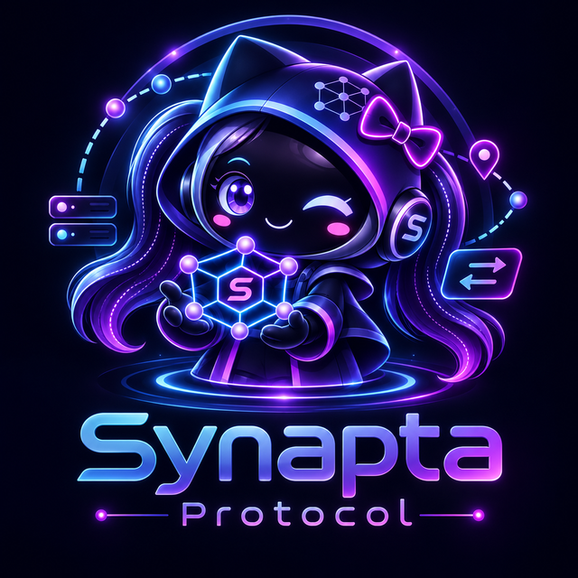

<p align="center"></p>

# Synapta Protocol

Protocol ให้ node หลายเครื่องค้นพบกัน ประกาศความสามารถ เลือกเครื่องที่จะทำงาน และส่งงาน / เรียก tool ข้ามเครื่องได้โดยตรง
ไม่มี server กลาง เขียนด้วย Rust + Tokio

> สถานะ: **v0.0.4 — Proof of Concept** รันได้และทดสอบได้จริงบนเครื่องเดียว (loopback) ยังไม่ใช่ production
> ข้อจำกัดทั้งหมดอยู่ที่ [`docs/roadmap.md`](docs/roadmap.md)

## แนวคิด

- **P2P** — ทุก node มี registry ของตัวเอง ไม่มีศูนย์กลางที่ต้องผ่าน
- **ประกาศความสามารถ** — node บอกว่าทำอะไรได้ (`math.add`, `test.execute`, …) และมีทรัพยากรเท่าไร
- **เลือกเครื่องด้วยกฎ ไม่ใช่ LLM** — policy ตายตัว อธิบายได้ทุกครั้งว่าทำไมเลือก/ไม่เลือกเครื่องไหน
- **เจาะจงเครื่องได้** — ระบุ `target` แล้วงานไปเครื่องนั้นเท่านั้น ถ้าไม่พร้อมได้ error ไม่แอบส่งไปเครื่องอื่น
- **UTCP** — agent ที่ใช้ UTCP client เรียก tool ของเครื่องอื่นผ่าน node ใกล้ตัวได้ (ทดสอบกับ SDK ทางการแล้ว)
- **ไม่ผูกกับ runtime ใด** — Syn-Script, Claude Code หรือ agent อื่นต่อเข้ามาเป็น executor ตัวหนึ่ง

## เริ่มเร็ว

ต้องมี Rust stable (ทดสอบกับ 1.99.1)

```
cargo test --workspace                              # เทสต์ทั้งหมด (unit + integration + E2E 3 process)
cargo run -p synapta-node --bin synapta-sandbox     # สาธิตครบ flow: เปิด node A/B/C แยก process แล้วรันทุกขั้น
```

`synapta-sandbox` เปิด node ทั้งสามเป็น process แยกบน `127.0.0.1:47321-47323` (API `48321-48323`)
ไล่ทดสอบ TEST-01…10 พิมพ์ request/response และ routing decision จริง แล้วสรุป PASS/FAIL
ทุกอย่าง (key, config, log แยกต่อ node, `transcript.json`) อยู่ในโฟลเดอร์ชั่วคราวที่บอกตอนจบ
ถ้า port ชนให้ใช้ `--auto-ports`

### รัน node เอง

```
synapta-node keygen --out examples/sandbox/keys/node-a.key      # ทำทั้ง a, b, c
synapta-node run --config examples/sandbox/node-c.toml          # แล้ว b, แล้ว a (คนละ terminal)
synapta --node examples/sandbox/data/node-a status
synapta --node examples/sandbox/data/node-a invoke math.add '{"a":2,"b":3}'
synapta --node examples/sandbox/data/node-a invoke test.execute '{"suite":"smoke"}' --target node-c
synapta --node examples/sandbox/data/node-a explain test.execute
```

คำสั่ง CLI ทั้งหมด: `synapta` (ไม่ใส่อะไร) จะแสดงวิธีใช้

### เทสต์กับ UTCP SDK ทางการ (Python)

```
python -m venv .venv-utcp && .venv-utcp/Scripts/pip install -r scripts/utcp-official/requirements.txt
SYNAPTA_UTCP_PYTHON=.venv-utcp/Scripts/python cargo test -p synapta-gateway --test utcp -- --include-ignored
```

ถ้าไม่ตั้ง `SYNAPTA_UTCP_PYTHON` เทสต์นี้จะขึ้นเป็น `ignored` (ไม่นับว่าผ่าน)

## โครงสร้าง

```
crates/
  synapta-core/      ตัว protocol: transport, handshake, discovery, registry, routing, execution
  synapta-gateway/   HTTP API ภายในเครื่องของ node: UTCP adapter + endpoint ควบคุม + client
  synapta-lab/       ????????????????????, trace/replay ?????????????????
  synapta-node/      โปรแกรม: synapta-node (daemon), synapta (CLI), synapta-sandbox (สาธิต/E2E)
examples/sandbox/    config ของ node A/B/C
scripts/utcp-official/  สคริปต์ทดสอบด้วย UTCP Python SDK ทางการ
docs/                เอกสาร (ดูด้านล่าง)
```

ถ้าส่วนไหนพัง เปิดตรงนี้ก่อน:

| อาการ | ไฟล์ |
|---|---|
| node หากันไม่เจอ / handshake ไม่ผ่าน | `synapta-core/src/discovery/{link,handshake}.rs` |
| เลือกเครื่องผิด / งานไม่กระจาย | `synapta-core/src/routing/mod.rs` (policy) · `routing/ledger.rs` (งานที่ส่งแล้วแต่ advert ยังไม่เห็น) · `routing/dispatch.rs` (ส่งงาน) |
| งานค้าง / ยกเลิกไม่ได้ | `synapta-core/src/execution/jobs.rs` |
| config ไม่ผ่าน | `synapta-core/src/config.rs` |
| UTCP client เรียกไม่ได้ | `synapta-gateway/src/utcp.rs` · `routes.rs` |

## เอกสาร

- [`docs/architecture.md`](docs/architecture.md) — ส่วนประกอบและการตัดสินใจหลัก
- [`docs/protocol.md`](docs/protocol.md) — สเปกข้อความบนสาย
- [`docs/routing.md`](docs/routing.md) — กฎการเลือก node
- [`docs/utcp-integration.md`](docs/utcp-integration.md) — UTCP adapter และผลทดสอบกับ SDK ทางการ
- [`docs/spec-review.md`](docs/spec-review.md) — ช่องโหว่ที่พบใน spec ต้นทาง และวิธีปิด
- [`docs/test-report.md`](docs/test-report.md) — ผลทดสอบพร้อมหลักฐาน
- [`docs/roadmap.md`](docs/roadmap.md) — ข้อจำกัดที่รู้แล้ว และแผนถัดไป

## ความปลอดภัย (v0.0.4)

- listen และ dial ได้เฉพาะ loopback — `0.0.0.0` ถูกปฏิเสธตั้งแต่ตรวจ config
- ทุกการเชื่อมต่อต้องผ่าน handshake แบบลายเซ็น Ed25519 สองทาง กับ key ที่อยู่ใน trust list เท่านั้น
- ทุก frame หลัง handshake เข้ารหัสและกันแก้ไข/ส่งซ้ำ (Noise NN, ChaCha20-Poly1305) key ใหม่ทุก connection
- ต่อรอง wire version ใน handshake และผูกไว้ในลายเซ็น — คนกลางหลอกให้ถอยไป version เก่าไม่ได้
- ก่อนยืนยันตัวตน รับข้อความได้ไม่เกิน 4 KiB
- เครื่องปลายทางเป็นคนตัดสินสิทธิ์ (`allow` ต่อ capability) — ไม่เชื่อการตรวจของฝั่งผู้เรียก
- ไม่มีโค้ดส่วนไหนใน core ที่รันคำสั่งบนเครื่องได้ (มีเทสต์กันไว้) executor ทั้งหมดเป็น mock ที่ไม่แตะ host
- private key และ API token เขียนแบบเจ้าของอ่านได้คนเดียว (Unix 0600)
